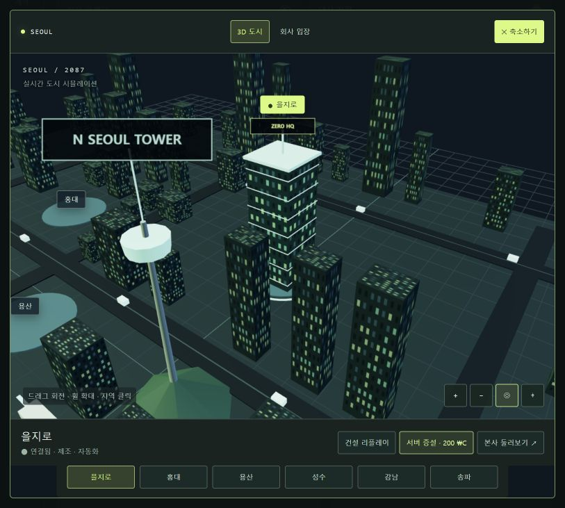

<!-- JUWON-PORTFOLIO-INTRO:START -->
# Seoul Zero

*Recorded execution screen showing the 3D Seoul city. This historical capture is not a guarantee of the current runtime.*

*기록된 실제 실행 화면 · 3D 서울*

## English

A browser-based AI-company management game set in Seoul in 2087, with a 3D city, districts, contracts, research, server operations, and a 30-day management loop.

[Play the public demo](https://seoul-zero-demo.juwonllee2026.workers.dev/). Public 3D rendering, accepting a contract, advancing a day and restoring browser saves were verified on 2026-10-09. This is a rule-based simulation, not a live AI company or payment service.

[View JUWON's portfolio](https://jupt.pages.dev/) · [Browse the project collection](https://jupt.pages.dev/projects)

**Scope:** This README presents the repository's documented intent and recorded visual evidence. It does not certify that every feature is complete, deployed, or currently working. Follow the original setup, safety, and license documentation below.

This repository is a selected original-source snapshot. The recorded source fingerprint describes the initial publication; this portfolio introduction was added afterward. Original technical documentation is preserved below.

## 한국어

3D 도시·회사, 계약·성장·연쇄 사건·추천 행동 화면이 구현된 경영 게임.

[공개 데모 체험하기](https://seoul-zero-demo.juwonllee2026.workers.dev/). 2026-10-09 공개 주소에서 3D 도시·계약·날짜 진행·저장 복원을 검증했습니다. 규칙 기반 시뮬레이션이며 실제 AI 회사 운영이나 결제가 아닙니다.

[JUWON 포트폴리오 보기](https://jupt.pages.dev/) · [전체 프로젝트 보기](https://jupt.pages.dev/projects)

**확인 범위:** 저장소의 문서상 목적과 기록된 화면 근거를 소개합니다. 모든 기능의 완성·배포·현재 정상 작동을 보증하지 않습니다. 설치법·안전 주의사항·라이선스는 아래 기존 문서를 확인하세요.

선택된 원본 소스의 공개 스냅샷입니다. 기록된 소스 지문은 최초 공개 시점을 나타내며, 이 포트폴리오 소개는 이후 추가했습니다. 기존 기술 문서는 아래에 보존했습니다.
<!-- JUWON-PORTFOLIO-INTRO:END -->

---

## Original documentation / 기존 문서

# 서울 제로 · SEOUL ZERO

2087년 서울을 배경으로 한 30일 AI 기업 경영 게임. 한국어 UI, 도시 지도, 6개 지역, 계약·연구·서버·시민 신뢰·도시 사건·결산 엔딩을 제공합니다.

## 실행

**3D 버전:** 아래 로컬 서버로 실행하세요. Three.js와 모든 에셋이 프로젝트에 포함되어 플레이 중 인터넷이나 API 키가 필요 없습니다. WebGL 2를 지원하는 브라우저가 필요합니다. `index.html`을 파일로 직접 열면 2D 호환 지도를 이용할 수 있습니다.

**로컬 서버:** Node.js 20 이상에서 이 폴더를 열고 `npm start` 또는 `node server.cjs` 실행. 브라우저에서 <http://127.0.0.1:4173> 접속. 서버 종료는 터미널에서 Ctrl+C. 4173 포트가 사용 중이면 PowerShell에서 `$env:PORT=4174` 후 실행하세요. 서버는 내 컴퓨터의 루프백 주소에만 바인딩됩니다.

## 플레이

### 3D 도시와 회사 탐방

- 기본 지도는 실제 WebGL 3D 도시입니다. 마우스 드래그로 회전, 휠 또는 +/-로 확대·축소, 우클릭 드래그로 이동합니다. 터치에서는 한 손가락 회전, 두 손가락 확대·이동을 지원합니다.
- **크게 보기**로 게임 화면 전체에 지도를 펼칩니다. **축소하기** 또는 Escape로 돌아옵니다. **◎ 선택 지역 확대**는 선택한 시설 가까이 카메라를 이동합니다. **⌖**는 기본 시점입니다.
- 지역을 연결하면 해당 AI 허브가, 서버를 증설하면 서버 센터가, 연구하면 연구동이 건설됩니다. 골조·크레인·층별 상승을 약 8초 동안 볼 수 있습니다. 경제 효과는 원래 규칙대로 즉시 적용되며, 건설 시간은 시각적 연출입니다.
- **건설 리플레이**는 보유 건물의 공사 장면만 다시 보여줍니다. 자금·행동력·저장을 바꾸지 않습니다.
- **회사 입장 / 본사 둘러보기**: 플레이어 캐릭터, 돌아다니는 직원, 책상, 연구·계약·서버 단말을 볼 수 있습니다. 서버 증설은 실내 랙 수에도 반영됩니다.
- **WASD / 방향키**로 이동합니다. 움직임은 현재 카메라 방향 기준입니다. 화면의 방향 버튼은 탭하거나 길게 누를 수 있습니다. 책상과 벽에 충돌하며 대각선 속도는 일정합니다.
- 단말의 원형 표시 근처로 걸어가면 **E** 또는 화면의 상호작용 버튼으로 계약·연구·운영 화면을 엽니다. 단말 사용은 메뉴 열기이며, 실제 투자는 해당 화면에서 선택합니다.
- 캐릭터 위치와 카메라는 같은 페이지 안에서 유지됩니다. 새로고침하면 로비에서 다시 시작합니다. 기존 경영 저장 파일은 그대로 호환됩니다.
- 3D를 사용할 수 없으면 **2D 지도 보기 · 호환 모드**에서 계속 플레이할 수 있습니다.
- 렌더러 1개를 재사용하고 30fps·픽셀 비율 1.5 상한을 적용합니다. 다른 화면이나 숨겨진 탭에서는 렌더링을 쉬고, 동작 줄이기 환경에서는 장식 움직임을 줄입니다.

### 경영 규칙

- 을지로 계약 수락으로 시작. 선불 비용 없이 2일 뒤 260 크레딧.
- 하루 행동력 3점. 계약 수락, 지역 진출, 연구, 서버 증설, 시민 지원에 각각 1점.
- `다음 날`을 누르면 기본 수입과 운영비 결산, 계약 진행, 행동력 회복.
- 완료 계약은 다시 수락 가능. 진행 중 계약은 연산 자원을 차지합니다.
- 홍대와 용산은 바로 진출 가능. 성수·강남·송파는 언어 모델 연구 필요.
- 3일마다 도시 사건 발생. 선택 결과는 버튼에 표시됩니다.
- 30일차 `최종 결산` 후 크레딧 1,500 이상 + 시민 신뢰 65 이상 + 연결 지역 3곳 이상이면 승리.
- 크레딧 음수 또는 신뢰 0이면 조기 종료. 모든 엔딩에서 재시작 가능.
- 운영 센터에서 다음 결산 금액, 서버 유지비, 자금 추이 확인.

단축키: **N** 다음 날, **1–5** 메뉴 전환, **?** 도움말. 지도에서 지역 선택, +/- 확대·축소. 작은 화면에서는 하단 메뉴 이용.

진행은 브라우저에 자동 저장. 설정에서 JSON 내보내기·불러오기, 효과음, 새 게임 제공. `file://`와 로컬 서버 주소의 저장소는 별개이며 브라우저 정책으로 저장이 차단될 수 있습니다. 파일 내보내기로 진행 상황을 보관하세요. 게임 속 AI는 규칙 기반 시뮬레이션이며 실제 AI 서비스 호출·결제는 없습니다.

## 검증

`npm test` — Node 기본 테스트 러너, 별도 패키지 설치 없음.

`engine.js`는 UI와 분리된 상태 전이 엔진. `world-model.js`는 시설·이동·충돌 모델, `world3d.mjs`는 3D 장면과 조작, `world-host.js`는 렌더러 수명과 경영 연결, `world.css`는 3D UI를 담당합니다. `city.js`는 2D 호환 지도이며 `app.js`는 UI·저장·입출력 담당입니다.

Three.js 0.184.0을 로컬에 포함합니다. 라이선스와 다운로드 출처·SHA-256은 `vendor/LICENSE.three.txt`, `vendor/manifest.json`에 있습니다. 재다운로드가 필요한 개발자만 `node scripts/vendor-three.cjs`를 실행하세요. 일반 실행에는 필요 없습니다.

기본 게임 기획·검증은 `docs/DESIGN.md`, `docs/VERIFICATION.md`에 있습니다. 3D 확장의 기획·검증은 `docs/3D-PLAN.md`, `docs/3D-VERIFICATION.md`와 스크린샷 2장을 참조하세요.
